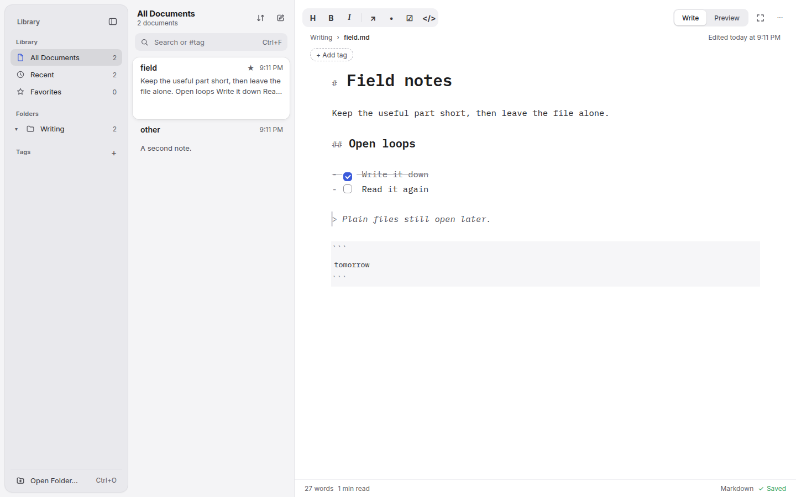
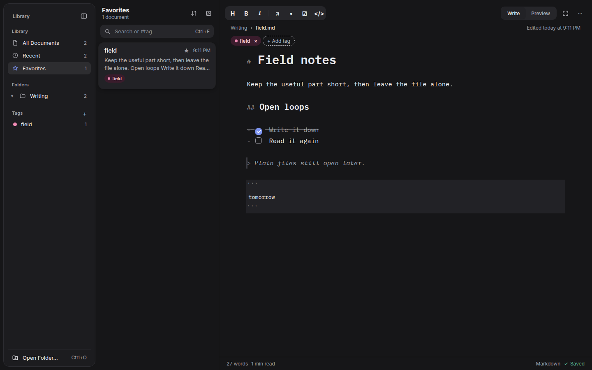
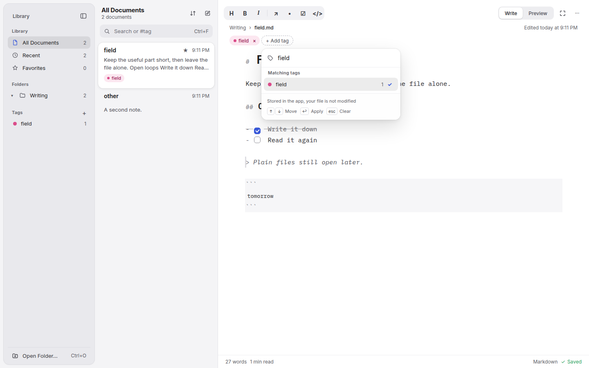
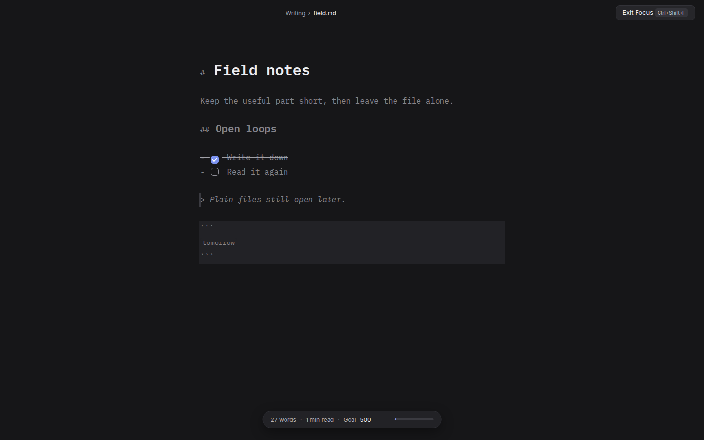

# Simple MD

A desktop Markdown editor. Open a folder, browse `.md` and `.markdown` files, edit them with live Markdown styling, and tag or favorite files without writing that into the files.









## Run

Install [Node.js 22](https://nodejs.org/) or newer, then:

```bash
npm ci
npm start
```

You can pass a folder path: `npm start -- /path/to/notes`.

The sidebar is a library: All Documents, Recent (edited in the last 14 days), Favorites, the folder tree, and tags. The middle column lists the documents for the selected section. It is windowed, and the two-line snippets are read when a row is shown and then cached, so a folder of thousands of files does not read every file up front. Empty folders stay visible. Folders that contain only other file types are hidden. `.git` and `node_modules` are skipped. The folder is scanned in the background so a large folder does not freeze the window. Symlink cycles are skipped, and directories deeper than 40 levels are not walked. Search matches the file name, the path, and tags. A query that starts with `#` matches tag names.

### macOS

```bash
npm ci
npm start
```

`npm run make` builds a zip. The app is not signed or notarized.

### Linux

```bash
npm ci
npm start
```

`npm run make` builds a `.deb` and an `.rpm`. Packaging needs `fakeroot`, `dpkg`, and `rpmbuild`. GitHub's Ubuntu image ships rpm 6, and that `rpmbuild` rejects the install script used by the rpm maker (`cp: cannot stat 'usr/*'`). CI therefore builds only the `.deb` there. A local `npm run make` is unchanged and still builds both.

### Windows

```bash
npm ci
npm start
```

`npm run make` builds a Squirrel installer. The app is not signed.

## Tags

Tags live in the app, not in the Markdown. For each opened folder, Simple MD keeps a JSON file in Electron's userData directory:

- macOS: `~/Library/Application Support/Simple MD/indexes/`
- Linux: `~/.config/Simple MD/indexes/`
- Windows: `%APPDATA%\Simple MD\indexes\`

The file name is the SHA-256 of the folder's real path. Each entry stores the tag names, whether the file is a favorite, plus the file's device id, inode, size, and modification time. Tag colors are chosen from a fixed palette (you can pick one when you create a tag) and stored in the same index. Saving a file does not rewrite it to include tags or favorites. There is no in-app trash view: Move to trash sends the file to the operating system's trash, and that trash cannot be listed here.

On open, and whenever the file list changes, the index is reconciled:

- A path that still exists keeps its tags.
- A missing path keeps its tags only when exactly one remaining file has the same device and inode (a typical same-volume rename or move).
- Otherwise the tags are dropped. Copies, cross-volume moves, and files deleted outside the app lose their tags. Replacing a file in an editor that writes a new inode is fine as long as the path stays the same.
- Rename and move inside the app update the index immediately.
- The index is tied to the folder's real path. Moving or renaming the folder itself starts a fresh index. The old file is left behind under the previous path and is not applied automatically.
- Filesystem inode reuse after a delete can, rarely, attach old tags to a new file.
- Symlinks that point outside the opened folder are ignored. Symlinks that resolve inside it are followed, and cycles are skipped.

`settings.json` in the same userData directory remembers the last opened folder and the focus-mode word goal. Nothing else about the file contents is stored, and the app does not send telemetry.

## Preview

GitHub Flavored Markdown is rendered in the app: tables, task lists, strikethrough, and fenced code with syntax highlighting. Relative links to other `.md` or `.markdown` files open in the app. Relative images (png, jpeg, gif, webp, avif) from inside the folder are shown. SVG and remote images are not loaded. External `http` and `https` links open in the default browser. HTML in the Markdown is escaped, and the rendered result is sanitized so scripts do not run.

Write is the default. Preview and a split view (More menu) are still there. The editor styles headings, emphasis, links, quotes, code, and task checkboxes while the Markdown source stays in the file. Cmd/Ctrl+S saves. The status bar shows the word count, a rough read time, and whether the file is saved. Leaving a dirty file asks before discarding it. If the open file changes on disk, a clean buffer reloads and a dirty buffer asks first.

Focus mode (Cmd+Shift+F, or Ctrl+Shift+F) hides the library and list, forces the dark theme, dims every paragraph except the one you are in, and shows a word-goal meter. The goal is stored in `settings.json`. The rest of the app follows the operating system's light or dark appearance.

The interface uses Inter and IBM Plex Mono, bundled from the `@fontsource` packages (SIL Open Font License). They are not loaded from the network. The content security policy keeps `font-src 'self'`. On macOS the window uses the native hidden-inset title bar; Windows and Linux keep the standard title bar. The traffic-light buttons are the system's, not drawn by the page.

## Unsigned builds

Local builds are unsigned.

On macOS, Gatekeeper blocks the app the first time. In Finder, control-click the app and choose Open, or clear quarantine:

```bash
xattr -dr com.apple.quarantine "/path/to/Simple MD.app"
```

On Windows, SmartScreen warns about an unrecognized app. Choose More info, then Run anyway.

## Scripts

- `npm start` runs the app.
- `npm test` runs unit tests.
- `npm run test:e2e` drives the production bundle under Electron. Run `npm run package` or `npm run make` first so `.vite/` is built. It needs a display (or `xvfb-run` on Linux). The packaged executable turns off Node's inspector, which the test runner uses, so the test launches the same built files with the Electron binary instead.
- `npm run lint` runs oxlint and oxfmt.
- `npm run typecheck` runs the TypeScript compiler.
- `npm run make` builds installers for the current platform.
- `npm run icons` regenerates `assets/icon.svg`, `icon.png`, `icon.icns`, and `icon.ico`. Forge runs the same script before packaging.

The package is private (`"license": "UNLICENSED"`). There is no LICENSE file. The rpm build repeats that field because `rpmbuild` requires one.

GitHub Actions (`.github/workflows/build.yml`) installs dependencies and builds on Ubuntu, macOS, and Windows. End-to-end tests run on Ubuntu only. That workflow is not executed from this environment.
